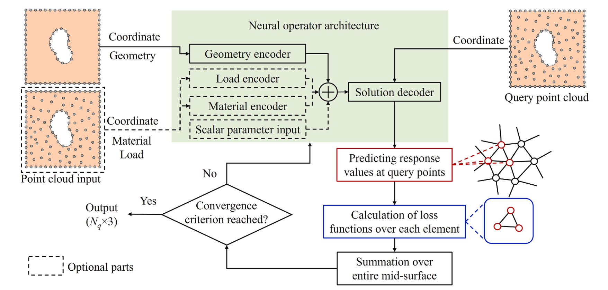

# GA-VINO: Geometry-Aware Variational Physics-Informed Neural Operator

Physics-informed operator learning for Mindlin-Reissner plates on varying geometries

Official publication: [Computer Methods in Applied Mechanics and Engineering](https://www.sciencedirect.com/science/article/pii/S0045782526008807)

This repository provides the implementation of **GA-VINO**, a geometry-aware variational physics-informed neural operator for predicting the transverse deflection and rotations of Mindlin-Reissner plates. GA-VINO represents plate geometry with boundary point clouds, combines geometry, material, loading, scalar-parameter, and query-point information through multi-branch encoders and cross-attention, and trains by minimizing a discretized total potential-energy functional.

Unlike conventional data-driven neural operators, the default GA-VINO training workflow does not require labeled solution fields. FEM solutions generated by this repository are used for evaluation and comparison; supervised baselines use them separately when requested.

> Paper: [GA-VINO: A Geometry-Aware Variational Physics-Informed Neural Operator for Mindlin-Reissner Plates](https://doi.org/10.1016/j.cma.2026.119609), *Computer Methods in Applied Mechanics and Engineering* 464 (2027) 119609.
>
> Local article: [GA-VINO.pdf](./GA-VINO.pdf)


<p align="center">
  
</p>

<p align="center">
  <em>Overall framework of the proposed GA-VINO method.</em>
</p>

---

## Features

- **Geometry-aware operator learning:** boundary point clouds encode plate domains with holes, cutouts, straight edges, and curved boundaries.
- **Variational physics-informed training:** the default loss is derived from the discretized total potential energy of Mindlin-Reissner plates and requires no FEM solution labels.
- **Flexible physical inputs:** dedicated branches handle heterogeneous material fields, spatially varying pressure or edge loads, and sample-level scalar parameters.
- **Decoupled inputs and queries:** geometry, material, load, and solution query points may use different point sets without interpolation onto a common regular grid.
- **Mechanical outputs:** the model predicts transverse deflection `w` and rotations `theta_x`, `theta_y`; postprocessing evaluates gradients, energies, bending moments, and transverse shear forces.
- **Multiple geometries and loading regimes:** single-hole, double-hole, L-shaped, and annular-sector plates are included.
- **Baselines and ablations:** supervised MSE, FNO, strong-form PINO, data-assisted physics training, Mindlin-Reissner/Kirchhoff-Love thickness studies, mesh studies, and multi-seed experiments are supported.
- **Cross-geometry evaluation:** scripts are provided for single-hole/double-hole transfer and L-shaped geometric out-of-distribution tests.

---

## Project Structure

```text
GA-VINO/
├── GA-VINO.pdf                 # Published article
├── README.md                   # Project documentation
│
├── NO/                         # Neural-operator implementation
│   ├── modules/                # Point encoders, positional encoding, Transformer
│   ├── common/                 # Models, training, evaluation, and physics losses
│   ├── problem/                # Geometry and sample definitions
│   ├── train/                  # Case-specific training entry points
│   └── outputs/                # Checkpoints, histories, and predictions
│
├── FEM/                        # FEniCSx reference solvers
│   ├── solvers/                # Mindlin-Reissner solvers and verification studies
│   └── outputs/                # FEM reference predictions
│
├── shared/                     # Data shared by FEM and neural operators
│   ├── prep/                   # Dataset and case preparation
│   ├── common/                 # Paths and data I/O
│   ├── compare/                # Metrics, plots, and resultants
│   ├── data/                   # Prepared train/test datasets
│   └── cases/                  # Exported per-sample FEM inputs
│
├── scripts/                    # Unified workflows and experiments
│   ├── stage1.py               # Prepare samples and generate FEM references
│   ├── stage2.py               # Train and evaluate neural operators
│   ├── postprocess_resultants.py
│   └── ood_*.py                # Cross-geometry/OOD evaluation
│
├── compare/                    # Final metrics and comparison figures
└── benchmarks/                 # Benchmark-related artifacts
```

Generated datasets, checkpoints, FEM solutions, and comparison figures can be large. Their standard locations are shown above.

---

## Requirements

Linux or WSL is recommended for the full FEM-to-neural-operator workflow.

- Python 3.10+ recommended
- PyTorch
- NumPy
- SciPy
- pandas
- Matplotlib
- Gmsh and its Python bindings
- FEniCSx stack: DOLFINx, UFL, Basix, PETSc, and MPI4Py
- CUDA-capable GPU recommended for training, but CPU execution is supported

The repository currently does not pin package versions. For reproducible experiments, record the resolved environment used for a run.

---

## Installation

Create an isolated environment and install the FEniCSx stack from `conda-forge`:

```bash
conda create -n ga-vino -c conda-forge \
  python=3.11 fenics-dolfinx mpi4py gmsh \
  numpy scipy pandas matplotlib
conda activate ga-vino
```

Install PyTorch for the required CPU or CUDA platform using the command provided by the [official PyTorch installer](https://pytorch.org/get-started/locally/). A CPU-only installation can be started with:

```bash
pip install torch
```

Then enter the repository root:

```bash
cd GA-VINO
```

Verify the two unified command-line interfaces:

```bash
python scripts/stage1.py --help
python scripts/stage2.py --help
```

---

## Quick Start

The standard workflow has two stages.

### Stage 1: prepare data and FEM references

```bash
python scripts/stage1.py --case hole_um_up --overwrite
```

This command prepares the single-hole dataset, exports per-sample FEM inputs, and computes FEM reference solutions. The references are used to evaluate the trained model; they are not labels in the default variational GA-VINO loss.

### Stage 2: train and evaluate GA-VINO

```bash
python scripts/stage2.py --case hole_um_up
```

Optional training overrides include:

```bash
python scripts/stage2.py --case hole_um_up \
  --epochs 500 --batch-size 4 --lr 1e-4 --device cuda
```

### Rebuild resultant comparisons

For existing FEM and neural-operator prediction files:

```bash
python scripts/postprocess_resultants.py --case hole_um_up
```

This updates per-sample metrics and generates comparisons of displacement, rotation, bending moments, and transverse shear forces without retraining or rerunning FEM.

---

## Numerical Examples

Case names use the abbreviations `UM` (uniform material), `GRFM` (Gaussian-random-field material), `UP` (uniform pressure), and `GRFP` (Gaussian-random-field pressure).

| Case | Description | Stage-1 / Stage-2 argument |
| --- | --- | --- |
| Single-hole UM-UP | Varying single-hole geometry, uniform material and pressure | `hole_um_up` |
| Single-hole UM-GRFP | Varying single-hole geometry and random pressure field | `hole_um_grfp` |
| Double-hole UM-UP | Varying double-hole geometry, uniform material and pressure | `holes2_um_up` |
| Double-hole UM-GRFP | Varying double-hole geometry and random pressure field | `holes2_um_grfp` |
| L-shape GRFM-UP | Varying L-shaped geometry and random material field | `lshape_grfm_up` |
| L-shape GRFM-GRFP | Varying geometry, material field, and pressure field | `lshape_grfm_grfp` |
| L-shape UM-GRFP | Varying L-shaped geometry and random pressure field | `lshape_um_grfp` |
| Annular sector GRFM-GRFP | Curved geometry, random material, and random nonuniform boundary line load | `annular_sector_grfm_grfp` |

For example:

```bash
python scripts/stage1.py --case annular_sector_grfm_grfp --overwrite
python scripts/stage2.py --case annular_sector_grfm_grfp
```

---

## Baselines and Additional Studies

### Supervised and physics-informed baselines

```bash
# Supervised nodal MSE baseline
python scripts/stage2.py --case hole_um_up_mse

# Strong-form physics-only and physics-plus-data baselines
python scripts/stage2.py --case hole_um_up_pino_strong
python scripts/stage2.py --case hole_um_up_pino_strong_data

# Variational energy plus labeled data
python scripts/stage2.py --case hole_um_up_energy_data

# Supervised FNO baselines for L-shaped plates
python scripts/stage2.py --case lshape_grfm_up_fno
python scripts/stage2.py --case lshape_grfm_grfp_fno
```

### Thickness and plate-theory study

```bash
python scripts/stage1.py --case hole_um_up_t0158 --overwrite
python scripts/stage2.py --case hole_um_up_t0158
python scripts/stage2.py --case hole_um_up_t0158 --method kl
python scripts/plot_thickness_l2_errors.py
```

### Discretization and mesh studies

```bash
python scripts/eval_hole_um_up_pc_density_node_l2.py
python scripts/hole_um_up_mesh_convergence.py all
python scripts/hole_um_up_mesh_quality.py all
```

### Multi-seed stability

```bash
# Inspect the experiment matrix without training
python scripts/run_seed_variability.py --dry-run

# Run paired multi-seed experiments
python scripts/run_seed_variability.py --device cuda --strict-determinism
```

---

## Cross-Geometry and OOD Evaluation

Prepare the target-case data and train the source-case model before running these scripts.

```bash
# Single-hole model evaluated on double-hole plates
python scripts/ood_hole_um_up_to_holes2_um_up.py

# Double-hole model evaluated on single-hole plates
python scripts/ood_holes2_um_up_to_hole_um_up.py

# L-shaped plates with larger out-of-distribution cutouts
python scripts/ood_lshape_grfm_up_065_to_085.py
```

Use `--checkpoint best` or `--checkpoint final` to select the source checkpoint. Run any script with `--help` for the complete options.

---

## Outputs

For a case named `<case>`, the main outputs are:

| Path | Contents |
| --- | --- |
| `shared/data/<case>/` | Prepared train/test samples, tags, and dataset metadata |
| `shared/cases/<case>/` | Per-sample inputs exported for FEM |
| `FEM/outputs/<case>/predictions/` | FEM reference fields |
| `NO/outputs/<case>/` | Checkpoints, training history, loss curves, and predictions |
| `compare/<case>/` | Final error tables and field/resultant comparison figures |

Most scripts accept `--root` to override the repository root. Stage 1 overwrites prepared data or FEM outputs only when `--overwrite` is supplied.

---

## Citation

If you find this code or the GA-VINO method useful, please cite:

```bibtex
@article{wang2027gavino,
  title   = {GA-VINO: A Geometry-Aware Variational Physics-Informed Neural Operator for Mindlin-Reissner Plates},
  author  = {Wang, Siqi and Sun, Daobo and Wang, Yizheng and Zhang, Yilong and Jin, Yabin and Zhuang, Xiaoying and Rabczuk, Timon},
  journal = {Computer Methods in Applied Mechanics and Engineering},
  volume  = {464},
  pages   = {119609},
  year    = {2027},
  doi     = {10.1016/j.cma.2026.119609}
}
```

---

## License

This repository does not currently include an open-source license. Unless a license is added, the source code remains under the copyright of its authors and no reuse rights are granted by default.

